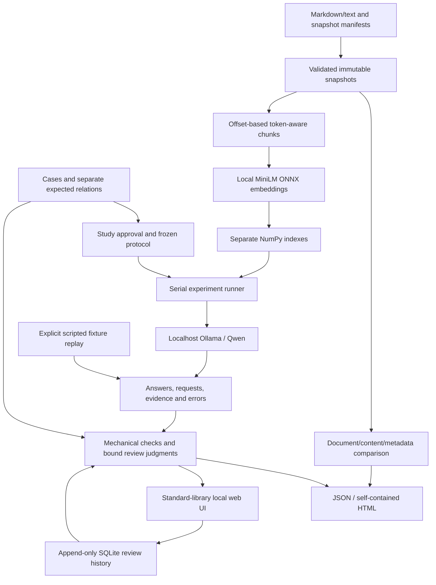

# KnowledgeDelta architecture

KnowledgeDelta tests a documentation assistant against two document snapshots.
Its main product is the comparison workflow and inspectable evidence report.
The reference assistant is a small local RAG pipeline: retrieve passages, then
ask a local language model to answer using those passages.

## Two paths through the system

Fixture replay constructs labeled demonstration records. It performs no model
inference and cannot supply live benchmark evidence. Importing a saved run also
performs no inference: the review controller preserves its answers and evidence.
An imported `live` label is a recorded claim, not authenticated execution.

## Snapshot and source identity

`snapshots.py` validates manifests and reads local UTF-8 Markdown/text. Documents
have stable IDs independent of their contents. Exact-byte content hashes and
semantic metadata hashes identify changes; canonical snapshot identity includes
the relevant document records, version scope, provenance and default version.
`diff.py` compares stable IDs to distinguish additions, removals, content changes
and metadata changes. A renamed path alone is not a new document identity.

Source URLs record provenance; loading a snapshot does not fetch those URLs.
Pinned upstream files, licenses and extraction recipes remain outside answering
indexes unless explicitly selected as documentation. Separate indexes are built
for each snapshot. This does not test a production connector's incremental
update or deletion machinery.

`cases.py` validates expectations, supporting quotations, version targets, split
and review metadata. An explicit version is stored once per question and remains
fixed across snapshots. Default-version questions require a manifest default.
Related families cannot cross the development/held-out boundary. Cases and gold
rubrics are separate inputs; `QuestionInput` supplies only the question and its
requested context to the answering pipeline.

## Local retrieval and answering

`chunking.py` preserves exact character spans and traceable chunk IDs. Its
tokenizer contract includes special tokens when checking the actual input limit;
it does not silently truncate. The current study uses 128-token chunks with
16-token overlap, below the MiniLM adapter's 256-token input limit.

`onnx_embeddings.py` loads pinned local all-MiniLM-L6-v2 assets through ONNXRuntime
with `CPUExecutionProvider`, sequential execution and one intra/inter-op thread.
The adapter uses attention-mask mean pooling and L2 normalization to produce
384-dimensional vectors. Asset hashes, model revision, adapter settings and
library versions enter its identity. This is a direct ONNX adapter; it does not
claim bitwise equivalence to running sentence-transformers through PyTorch.
The earlier sentence-transformers adapter remains an explicit alternate backend,
with no automatic fallback.

`retrieval.py` normalizes finite vectors and uses NumPy cosine similarity. Each
index is bound to one snapshot, embedder and chunk configuration. Basic retrieval
and exact-label version filtering share the remaining pipeline settings. Missing
applicability stays visible; the system does not infer that newer means relevant.

`pipeline.py`, `prompts.py` and `ollama.py` record the exact selected passages,
messages, requested JSON schema, model tag/digest, configuration identities,
timings, attempts and available token statistics. Document text is untrusted
quoted evidence, never an instruction source. Requests go to the fixed local
Ollama service, with bounded responses/retries and serialized generation. The
study requests `think=false`, CPU operation and a 4,096-token context with a
256-token output cap. These requested settings do not by themselves prove
effective context handling, hardware residency or determinism.

No applicable passages produces a recorded evidence-only policy abstention
without a model call. Successful JSON validation is not answer correctness.
Malformed or interrupted generations remain explicit errors. There is no answer
cache in the current experiment path; repeated measurements generate fresh
requests. Index reuse within a bundle is recorded separately from answer caching.

## Evaluation, review and metrics

`evaluation.py` first judges each snapshot independently, then derives comparison
status. Schema/citation membership and compatible cited versions can be checked
mechanically. Semantic correctness and passage support require an appropriate
review; keyword presence cannot produce a pass. Imported controls and recorded
generation provenance are checked for internal contradictions.

Review bindings include the run/result key, dataset, case, expectation, snapshot
and complete trace hashes. `review_store.py` appends SQLite events with optimistic
revision checks; it does not overwrite earlier judgments. `review_workflow.py`
shows stale history but does not reuse stale judgments for current answers.
The journal is application-level history, not a tamper-proof audit service.

`metrics.py` separates assistant measurements from testing-tool measurements.
It preserves planned, recorded, missing, error and unresolved counts. Human
accuracy excludes fixture oracles and unqualified draft cohorts. Failure-flag
precision/recall needs separate reference annotations; the tool's own flags
cannot be relabeled as their ground truth. Blanket owner authorization and agent
source checks remain distinct from item-specific human review; see
[REVIEW_PROVENANCE.md](REVIEW_PROVENANCE.md).

## Interface, exports and execution boundaries

`web_app.py` serves packaged HTML/CSS/JavaScript using Python's standard library.
It binds to localhost and checks host/origin and per-process CSRF tokens for
mutations. Browser rendering uses text-safe DOM construction; HTML reports escape
source and answer content and require no external assets. The standard UI does
not import pandas or require a JavaScript build system. The former Streamlit path
is legacy and is not the current startup path.

`workflow.py` exports project-contained JSON and HTML without overwriting changed
reports, source files or active environments. Reports carry the raw traces,
expectations, checks and review provenance. A static export cannot establish
whether a passage actually supported an answer beyond the recorded judgments.

Setup/download scripts are explicit actions, separate from ordinary tests and
startup. Existing assets are checked by size/hash; persistent reservations include
retries within the approved artifact budget. Project-folder space checks are
software planning checks, not an operating-system quota. Runtime/model state is
configured for the project folder. Windows protection remains enabled; a blocked
DLL or denied operation is reported rather than bypassed.

The core package has no runtime dependencies. Local model/embedding assets are a
separate optional setup. A package wheel and fresh offline installation were
actually exercised on Windows AMD64/Python 3.14.10; that is not a clean-machine
verification of every ML dependency or every declared Python version. Evidence:
[packaging verification](evidence/milestone5-packaging/5d91234240764963b46e6e277c227eef.json).

## Decisions worth explaining in an interview

- A stable document ID and a content hash answer different questions: which
  document is this, and did its bytes change?
- A changed answer is a regression only after comparison with each snapshot's
  own expectation. Evidence removal does not make the underlying fact false.
- Version filtering is the controlled retrieval intervention; other settings
  stay fixed. A better completion rate is not a better correctness score.
- Separate snapshot indexes and explicit traces make a small study reproducible
  without a vector database, agent framework or hosted model service.
- Hash-bound reviews prevent an old approval from silently grading a new answer.
  They establish record consistency, not reviewer independence or identity.

See [DATASET_CARD.md](DATASET_CARD.md), [EVALUATION.md](EVALUATION.md), and
[EXPERIMENT_RESULTS.md](EXPERIMENT_RESULTS.md) for the study scope and actual
results. The current 60-case execution is in progress; this architecture document
does not claim completed held-out results.
