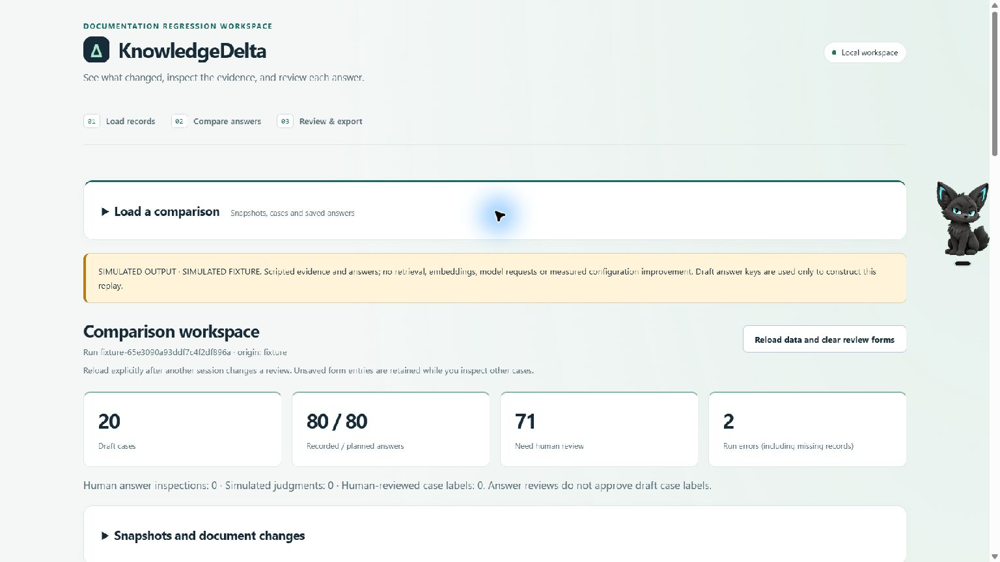
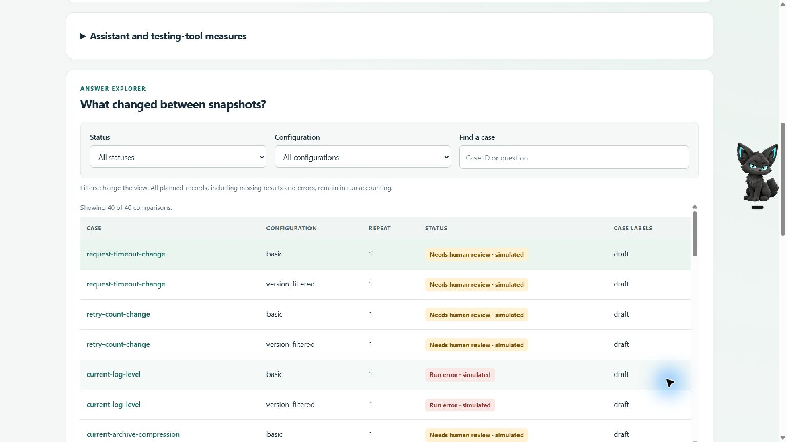
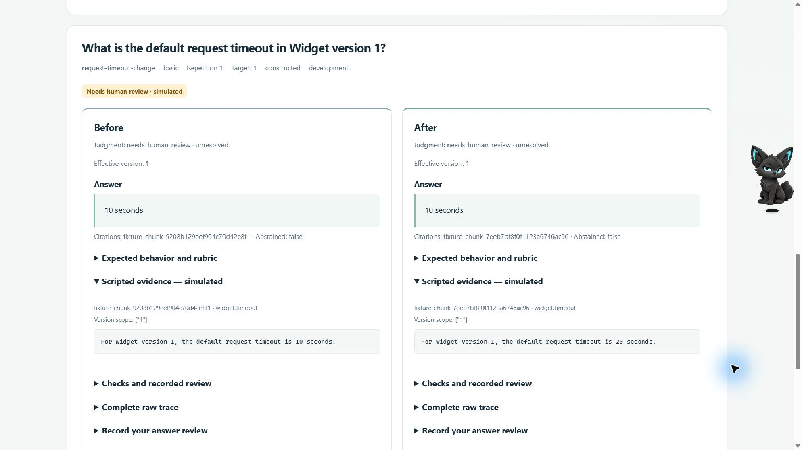

# Showcase materials

These screenshots were captured from the actual local application in Chrome.
They show the explicitly labeled scripted fixture workflow. They are not model
benchmark screenshots or fabricated UI mockups. The desktop pet visible in the
right margin is external to KnowledgeDelta.

## Comparison workspace

## Case explorer

## Exact evidence inspection

The example intentionally retains an old answer while the supplied passage
changes from 10 to 20 seconds. Its unresolved judgment is visible; this is a
workflow demonstration, not a human-graded live regression.

## Actual recorded example

For live evidence use the actual reviewed dict-pairs report under
`docs/portfolio/reviewed-example/`. The reproducible generator is
`docs/evidence/milestone5-demo-report/reproduce_report.py`; it verifies the
archived raw hash and exact published human-review counts/metrics without
calling a model or opening the private review database.

Use [the demo script](DEMO_SCRIPT.md), [case study](CASE_STUDY.md),
[architecture](ARCHITECTURE.md) and [review provenance](REVIEW_PROVENANCE.md)
alongside these images. A completed video is a separate artifact, not implied
by this gallery or its script.
